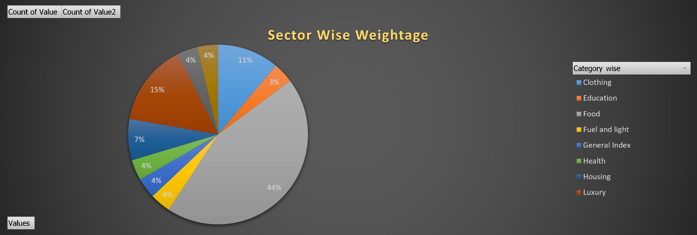
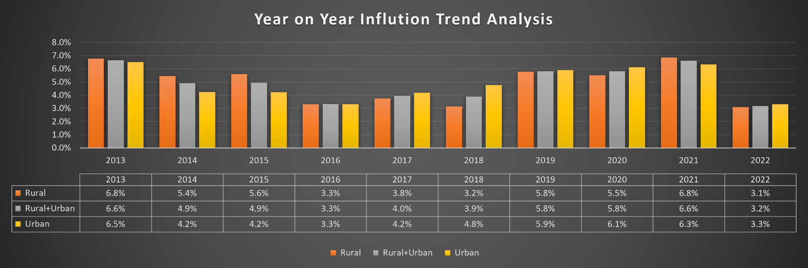
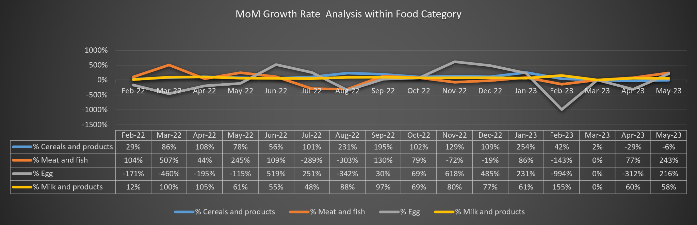
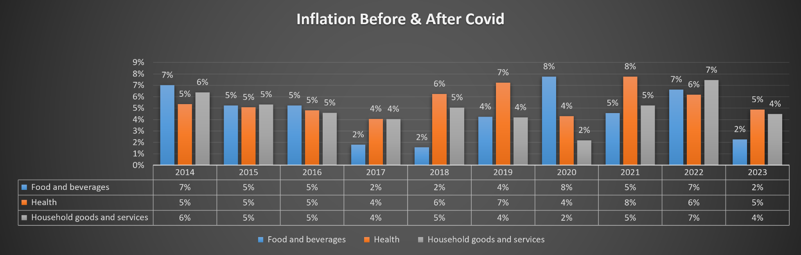

<div align="center">

# 📊 Consumer Price Index (CPI) Inflation Analysis

### Excel Dashboard • Category Trends • Rural vs Urban • Year-on-Year Analysis

*A portfolio project exploring consumer price index patterns across sectors, categories, and time.*


</div>

---

## 📌 Project Overview

This project explores Consumer Price Index (CPI) data in Microsoft Excel to understand how price-index values vary across categories, sectors, and time. The workbook includes raw and transformed data, supporting analysis sheets, and a dashboard with visual comparisons.

The goal is to turn a wide, detailed dataset into a more accessible view of inflation patterns and category-level movement.

> **Important:** CPI index values and inflation rates are not the same measure. Interpret each chart according to its label and calculation. Review the workbook's source and calculation definitions before using results for formal reporting.

## 🎯 Objectives

- Compare category weightage across the available categories.
- Examine year-on-year inflation trends for rural, urban, and combined populations.
- Explore month-on-month movement in selected food categories.
- Compare selected category trends before and after the COVID period.
- Organize wide-format source data into a long/unpivoted structure for analysis.
- Present findings through Excel charts, pivot-style summaries, and dashboard visuals.

## 🖼️ Dashboard & Visuals

### 1. Sector-wise Weightage
Shows the distribution of category weightage represented in the workbook.



### 2. Year-on-Year Inflation Trend
Compares annual inflation rates for Rural, Rural+Urban, and Urban series from 2013–2022.



### 3. Month-on-Month Growth Rate — Food Categories
Displays monthly growth-rate movement for selected food categories. Very large positive or negative percentages can occur when the prior-period denominator is small or when the underlying calculation needs review; validate outliers before drawing conclusions.



### 4. Inflation Before & After COVID
Compares selected category series across 2014–2023.



## 🗂️ Repository Structure

```text
CPI-Inflation-Analysis/
├── data/
│   └── CPI-Inflation-Analysis.xlsx
├── screenshots/
│   ├── 01-sector-wise-weightage.png
│   ├── 02-year-on-year-inflation-trend.png
│   ├── 03-month-on-month-food-growth.png
│   └── 04-inflation-before-after-covid.png
├── docs/
│   └── DATA_NOTES.md
├── .gitignore
├── LICENSE
└── README.md
```

## 📁 Workbook Guide

The Excel workbook contains these sheets:

| Sheet | Purpose |
|---|---|
| `RAW DATA` | Source-style wide-format dataset |
| `CPI Inflation` | Main CPI table arranged for analysis |
| `UNPIVOT DATA` | Long-format data with category/attribute and value fields |
| `DASHBOARD` | Dashboard presentation |
| `INSIGHT 1` | Category weightage summary |
| `INSIGHT 2` | General index comparison by year and sector |
| `INSIGHT 3` | Monthly averages for selected food categories |
| `INSIGHT 4` | Annual category summaries for food, health, and household goods/services |
| `INSIGHT 5` | Fuel and transport/communication summaries |

Sheet names and contents are documented from the included workbook; confirm the workbook itself for the exact formulas and pivot settings.

## 🔎 Suggested Analysis Questions

1. How do Rural, Urban, and Rural+Urban annual inflation rates compare?
2. Which categories have the largest share in the category-weightage view?
3. Which food categories show the most volatile monthly growth?
4. How do selected categories differ between the pre-COVID and post-COVID years?
5. Which outliers should be checked against source values and calculation logic?

## 🛠️ Tools & Skills Demonstrated

- Microsoft Excel
- Data organization and transformation (wide-to-long / unpivot)
- Pivot-style summaries
- KPI and trend visualization
- Category and time-series comparison
- Dashboard design and data storytelling

## 🚀 How to Use

1. Download or clone this repository.
2. Open `data/CPI-Inflation-Analysis.xlsx` in Microsoft Excel.
3. Start with `DASHBOARD` for the visual overview.
4. Review the `INSIGHT` sheets for supporting summaries.
5. Inspect `RAW DATA`, `CPI Inflation`, and `UNPIVOT DATA` to trace values back to the underlying records.
6. Validate the source, formulas, and outlier handling before reusing the analysis.

**Recommended:** Use desktop Excel if the workbook contains pivot tables, slicers, or interactive dashboard controls. Some features may not behave identically in other spreadsheet applications or in a browser preview.

## 📈 Key Takeaways

Use the visuals to explore the following patterns rather than treating them as final conclusions:

- Annual inflation differs across rural and urban series in some years.
- Category-level movements can vary substantially over time.
- Monthly percentage growth charts may contain extreme values and should be checked against the underlying index values and formula.
- A well-structured unpivoted dataset makes category-based comparisons easier.

The workbook should be reviewed and validated before presenting numeric findings as official or definitive.

## 📚 Data Source & Methodology

The uploaded workbook is included as the project data file. The source attribution, release/version, geographic scope, base year, and calculation methodology were not supplied separately with the file.

Before publishing the repository publicly, add the original data source and any required attribution here. Confirm that the data is permitted to be redistributed. Also document how each growth/inflation percentage was calculated, including the comparison period and denominator.

See [`docs/DATA_NOTES.md`](docs/DATA_NOTES.md) for a validation checklist.

## 👤 About This Project

This repository is intended as a data-analytics portfolio project demonstrating spreadsheet analysis, trend interpretation, and dashboard communication.

If you found this project useful, feel free to ⭐ the repository.

---

<div align="center">

**Built with Excel | Prepared for a Data Analytics Portfolio**

</div>
